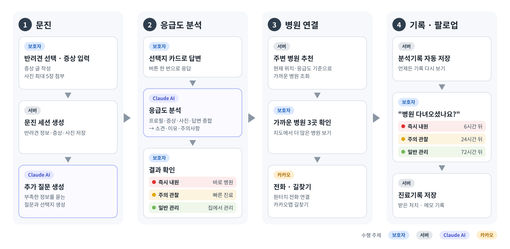
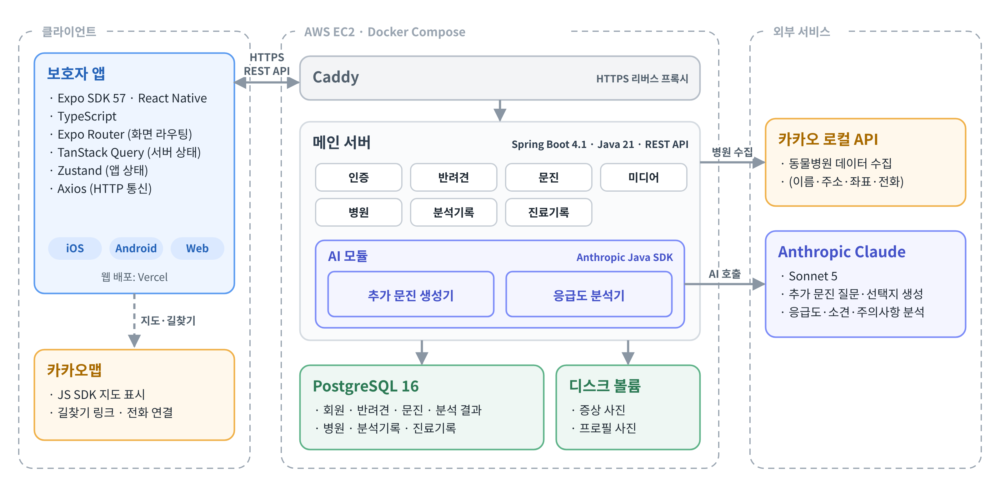
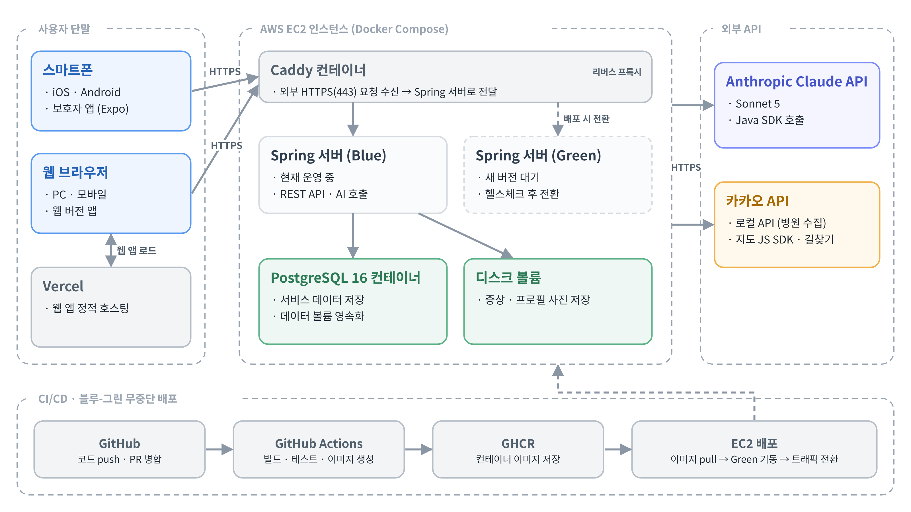

# 이멍전시 (BabyMungsoo_BE)

> 우리 아이, 지금 병원에 가야 할까요?

**이멍전시**는 반려견의 증상을 보고 **지금 병원에 가야 하는지**를 AI 가 판단해 주고,
가까운 동물병원까지 연결해 주는 보호자용 응급도 판단 서비스입니다.
이 저장소는 인증 · 반려견 · 문진 · 병원 · 기록 API 와 Claude 기반 AI 모듈을 제공하는 메인 서버입니다.

- 프론트엔드(보호자 앱): [BabyMungsoo_FE](https://github.com/BabyMungsoo/BabyMungsoo_FE)

> [!NOTE]
> 이멍전시의 결과는 수의사의 진단을 대신하지 않습니다. AI 출력에는 병명 · 진단명 · 투약 지시가
> 들어가지 않도록 스키마와 후처리로 제한합니다.

---

## 목차

- [서비스 흐름](#서비스-흐름)
- [시스템 구성](#시스템-구성)
- [AI 모듈](#ai-모듈)
- [기술 스택](#기술-스택)
- [API](#api)
- [시작하기](#시작하기)
- [배포](#배포)
- [폴더 구조](#폴더-구조)
- [협업 규칙](#협업-규칙)

---

## 서비스 흐름



1. **문진** — 보호자가 반려견을 고르고 증상 글 · 사진(최대 5장)을 올리면 서버가 문진 세션을 만들고,
   Claude 가 부족한 정보를 묻는 추가 질문과 선택지를 생성합니다.
2. **응급도 분석** — 프로필 · 증상 · 사진 · 답변을 종합해 Claude 가 응급도와 소견 · 이유 · 주의사항을 판단합니다.
3. **병원 연결** — 현재 위치와 응급도를 기준으로 가까운 동물병원을 추천합니다.
4. **기록 · 팔로우업** — 분석기록을 자동 저장하고, 보호자가 남긴 내원 여부와 진료기록을 저장합니다.

### 응급도 3단계

| 값          | 표시            | 의미                            |
| ----------- | --------------- | ------------------------------- |
| `IMMEDIATE` | 🔴 **즉시 내원** | 지금 바로 병원에 가야 하는 상태 |
| `WATCH`     | 🟡 **주의 관찰** | 빠른 시일 내 진료가 필요한 상태 |
| `NORMAL`    | 🟢 **일반 관리** | 집에서 관리해도 괜찮은 상태     |

---

## 시스템 구성

### 소프트웨어 구성도



### 하드웨어 · 배포 구성도



- 앱 · 웹은 HTTPS 로 **Caddy**(리버스 프록시)에 붙고, Caddy 가 현재 운영 중인 Spring 서버(블루 또는 그린)로 전달합니다.
- 데이터는 **PostgreSQL 16**, 증상 · 프로필 사진은 **디스크 볼륨**에 저장합니다.
- 외부 서비스로 **Anthropic Claude API**(문진 질문 생성 · 응급도 분석)와
  **카카오 로컬 API**(동물병원 데이터 수집)를 사용합니다.

---

## AI 모듈

`AI/` 패키지에 두 개의 구현체가 있고, 각각 인터페이스 뒤에 숨어 있어 실제 호출과 Stub 을 설정으로 바꿀 수 있습니다.

| 역할           | 인터페이스                | 실제 구현                       | 개발용 Stub                   |
| -------------- | ------------------------- | ------------------------------- | ----------------------------- |
| 추가 문진 생성 | `TriageQuestionGenerator` | `ClaudeTriageQuestionGenerator` | `StubTriageQuestionGenerator` |
| 응급도 분석    | `TriageAnalyzer`          | `ClaudeTriageAnalyzer`          | `StubTriageAnalyzer`          |

- **Anthropic Java SDK** 로 Claude Sonnet 5 를 호출합니다. 질문 생성 모델은 `CLAUDE_QUESTION_MODEL` 로 따로 바꿀 수 있습니다.
- 분석 결과는 **구조화 출력**으로 받습니다. [`ClaudeTriageResult`](src/main/java/com/example/babymungsoo/AI/Dto/ClaudeTriageResult.java) 의
  필드 설명이 곧 모델에 전달되는 스펙이며, 응답은 응급도 · 소견(2~4개) · 응급도 이유 · 악화 신호 · 주의사항으로 구성됩니다.
- 결론 문구("지금 병원에 가야 해요" 등)는 모델이 아니라 응급도 값으로 코드가 만듭니다. 등급과 결론이 어긋나지 않게 하기 위해서입니다.
- `CLAUDE_API_MOCK=true`(개발 기본값)이면 Stub 이 응답해 **실제 호출 · 과금이 일어나지 않습니다.** 운영(`prod`) 프로필은 기본값이 `false` 입니다.

---

## 기술 스택

| 영역       | 선택                                                           |
| ---------- | -------------------------------------------------------------- |
| 언어       | Java 21                                                        |
| 프레임워크 | Spring Boot 4.1 (Web MVC, Data JPA, Security, Validation)      |
| 인증       | JWT (jjwt)                                                     |
| DB         | PostgreSQL 16                                                  |
| AI         | Anthropic Java SDK (Claude Sonnet 5)                           |
| 외부 API   | 카카오 로컬 API (동물병원 장소 검색)                           |
| API 문서   | springdoc-openapi (Swagger UI)                                 |
| 인프라     | AWS EC2, Docker Compose, Caddy, Terraform                      |
| CI/CD      | GitHub Actions → GHCR → EC2 self-hosted 러너, 블루-그린 배포   |

---

## API

모든 API 는 `/api/v1` 아래에 있습니다. 서버를 띄운 뒤 아래 주소에서 전체 스펙을 볼 수 있습니다.

- Swagger UI: `http://localhost:8080/swagger-ui.html`
- OpenAPI JSON: `http://localhost:8080/api-docs`

| 도메인        | 경로                                     | 주요 기능                                                   |
| ------------- | ---------------------------------------- | ----------------------------------------------------------- |
| 인증          | `/auth`                                  | 회원가입, 이메일 중복 확인, 로그인 / 로그아웃, 아이디 찾기, 비밀번호 재설정 |
| 사용자        | `/users/me`                              | 내 정보 조회, 비밀번호 변경, 회원 탈퇴                      |
| 반려견        | `/pets`, `/breeds`                       | 반려견 등록 · 조회 · 수정 · 삭제, 품종 목록                  |
| 문진          | `/triage`                                | 문진 세션 생성, 추가 질문 생성 · 답변, 응급도 분석            |
| 미디어        | `/media`                                 | 증상 · 프로필 사진 업로드 및 조회 (이미지만 허용)             |
| 병원          | `/hospitals`                             | 병원 목록 · 상세, 가까운 병원 조회, 응급도 기준 병원 추천     |
| 분석기록      | `/records`                               | 분석기록 저장 · 목록 · 상세 · 수정 · 삭제                     |
| 진료기록      | `/records/{recordId}/visits`, `/visits`  | 내원 여부 · 받은 처치 · 메모 기록                            |
| 리포트        | `/reports`                               | 분석기록 · 병원별 리포트 생성 · 조회 · 삭제                  |
| 관리자        | `/admin/hospitals`, `/admin/pets`        | 병원 데이터 시드, 반려견 조회 (ADMIN 전용)                  |

계정 복구 API 의 요청 · 응답 예시는 [docs/account-recovery.md](docs/account-recovery.md) 를 참고하세요.

---

## 시작하기

### 요구 사항

- JDK 21
- Docker (로컬 PostgreSQL 용)

### 1. 환경 변수

```bash
cp .env.example .env
```

`.env` 는 Spring 이 직접 읽고(`spring.config.import`), Docker Compose 도 같은 파일을 씁니다.

| 변수                           | 설명                                                                 |
| ------------------------------ | -------------------------------------------------------------------- |
| `SPRING_PROFILES_ACTIVE`       | `dev`(로컬) / `prod`(운영)                                           |
| `POSTGRES_*`                   | Docker Compose 로 띄울 PostgreSQL 의 포트 · DB 이름 · 계정             |
| `SPRING_DATASOURCE_*`          | 서버가 붙을 DB 주소 · 계정 (예: `jdbc:postgresql://localhost:5432/babymungsoo`) |
| `CLAUDE_API_KEY`               | Anthropic API 키                                                     |
| `CLAUDE_API_MOCK`              | `true` 면 Stub 응답(과금 없음), `false` 면 Claude 실제 호출           |
| `KAKAO_REST_API_KEY`           | 카카오 로컬 **REST API 키** (병원 데이터 수집용)                     |
| `JWT_SECRET`                   | JWT 서명 키 (충분히 긴 랜덤 문자열)                                  |
| `JWT_ACCESS_TOKEN_EXPIRATION_MS` | 액세스 토큰 만료 시간 (기본 1시간)                                 |
| `ADMIN_EMAIL` / `ADMIN_PASSWORD` / `ADMIN_NAME` | 기동 시 만들 관리자 계정. 비우면 만들지 않음          |
| `CORS_ALLOWED_ORIGIN_PATTERNS` | 허용할 프론트 출처 (기본 `http://localhost:*`)                       |

### 2. DB 실행

```bash
docker compose up -d postgres
```

### 3. 서버 실행

```bash
./gradlew bootRun
```

서버는 `http://localhost:8080` 에서 뜹니다. 앱을 붙이는 방법은 [FE README](https://github.com/BabyMungsoo/BabyMungsoo_FE#시작하기)를 참고하세요.

- `dev` 프로필에서는 병원 테이블이 비어 있으면 기동 시 **카카오 로컬 API 로 전국 동물병원 데이터를 자동 수집**합니다.
  카카오 키가 없으면 수집만 건너뛰고 서버는 정상 기동합니다.
- `ddl-auto: update` 로 스키마를 자동 생성합니다.

### 테스트

```bash
./gradlew test
```

---

## 배포

`main` 에 push(= `develop` → `main` PR 머지)되면 [`cd.yml`](.github/workflows/cd.yml) 이 운영 서버에 **무중단 배포**합니다.

1. **build** — GitHub 호스팅 러너에서 테스트 후 Docker 이미지를 빌드해 GHCR 에 push
2. **deploy** — 운영 EC2 의 self-hosted 러너가 이미지를 받아 [`deploy.sh`](infra/terraform/files/deploy.sh) 로 블루-그린 전환
   (새 컨테이너를 띄우고 `/actuator/health` 확인 후 Caddy 의 트래픽 대상을 바꿈)

PR 마다 [`ci.yml`](.github/workflows/ci.yml) 이 PostgreSQL 을 띄워 `./gradlew clean build` 를 실행합니다. CI 에서는 Claude 를 실제로 호출하지 않습니다.

- `prod` 프로필에서는 병원 자동 수집이 돌지 않습니다. 첫 배포 후 관리자 계정으로
  `POST /api/v1/admin/hospitals/seed-nationwide` 를 한 번 호출해 주세요.
- EC2 · 네트워크 구성과 서버 초기 설정은 [infra/terraform/README.md](infra/terraform/README.md) 에 정리돼 있습니다.

---

## 폴더 구조

```
src/main/java/com/example/babymungsoo/
├── AI/            # Claude 연동: 추가 문진 생성기 · 응급도 분석기, 분석 결과 저장
├── auth/          # 회원가입 · 로그인 · 계정 복구
├── user/          # 사용자 정보
├── pet/           # 반려견 · 품종
├── triage/        # 문진 세션 · 질문 · 답변
├── media/         # 사진 업로드 · 조회
├── hospital/      # 병원 조회 · 추천, 카카오 로컬 API 클라이언트, 데이터 시드
├── record/        # 분석기록 · 진료기록(내원)
├── report/        # 리포트
└── global/        # 보안(JWT) · 예외 처리 · 공통 응답 · 파일 저장소 · 설정
src/main/resources/
├── application.yml        # 공통 설정
├── application-dev.yml    # 로컬 개발
├── application-prod.yml   # 운영
└── data/                  # 서울 24시간 병원 등 큐레이션 데이터
infra/terraform/           # AWS 인프라 · 서버 설정(Caddyfile, compose, deploy.sh)
docs/                      # API 메모, README 다이어그램
```

---

## 협업 규칙

### 브랜치 전략

```
main                배포용. develop 에서만 머지합니다. (push 시 자동 배포)
develop             개발 기본 브랜치. PR 은 전부 여기로.
feat/이름_이슈번호   예) feat/yuyeon_10
```

기능 브랜치는 **항상 develop 에서** 따고, 작업이 끝나면 develop 으로 PR 을 올립니다.

| 접두사      | 용도                     |
| ----------- | ------------------------ |
| `feat/`     | 기능 개발                |
| `fix/`      | 버그 수정                |
| `refactor/` | 동작 변화 없는 구조 개선 |
| `chore/`    | 설정 · 빌드 · 문서       |

### 커밋 메시지

```
feat: 반려견 등록 API 구현
fix: 분석 기록 수정에서 AI 판단값을 받지 않도록
chore: CI 워크플로 추가
```

`feat` / `fix` / `refactor` / `style` / `chore` / `docs` 를 씁니다.
